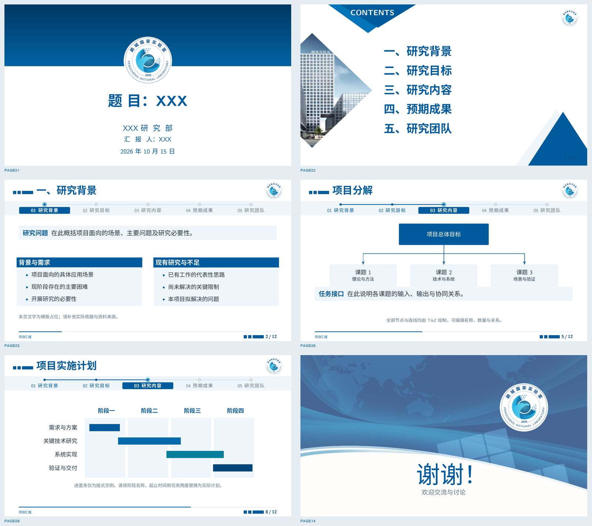
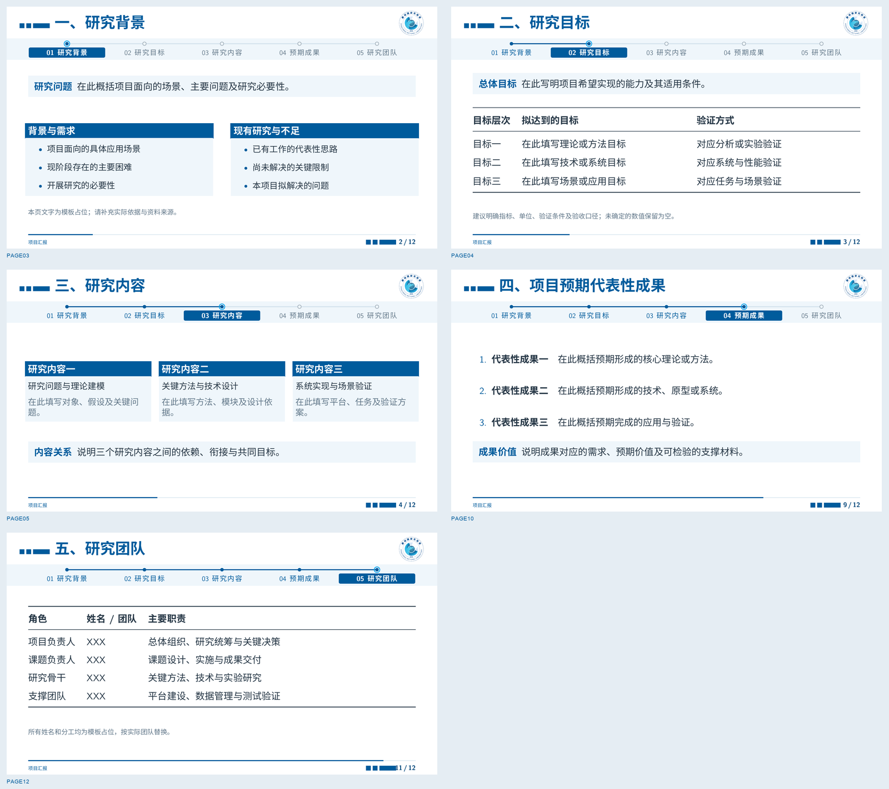

# PCL-PPT · 鹏城实验室 Beamer 模板

用于项目汇报的中文 LaTeX Beamer 模板：16:9、白底蓝字、圆形实验室标识、建筑照片目录页，
以及可点击的章节时间线。包含完整示例和精简起始版本，各 14 页。

**[完整示例 PDF](examples/main.pdf) · [精简版 PDF](examples/starter.pdf) · [起始源码](starter.tex)**

**矢量标识：[PDF](assets/pcl-emblem-vector.pdf) · [SVG](assets/logo/pcl-emblem-vector.svg) · [Illustrator 可编辑主稿](assets/logo/pcl-emblem-editable.ai)**



## 快速开始

安装带 XeLaTeX 和 latexmk 的 TeX Live，然后运行：

```bash
git clone https://github.com/rudykon/PCL-PPT.git
cd PCL-PPT
./build.sh
```

编译结果位于 `examples/main.pdf` 和 `examples/starter.pdf`。
日志及中间文件写入 `build/`，该目录不进入版本控制。

```bash
./build.sh main       # 仅编译完整示例
./build.sh starter    # 仅编译精简版
./build.sh clean      # 清理 build/ 中的编译产物，保留 examples/ 中的 PDF
```

也可以执行 `latexmk main.tex` 或 `latexmk starter.tex`，结果在 `build/`。
在 Overleaf 中上传本仓库文件，将编译器设为 **XeLaTeX**，选择 `main.tex` 或 `starter.tex` 为主文件。

常规宏包依赖：Beamer、fontspec、xeCJK、PGF/TikZ、amsmath、booktabs、tabularx。
编译无需 PowerPoint、LibreOffice、原始 PPTX、网络或 Python。

## 项目结构

```text
PCL-PPT/
├── main.tex                    # 完整版式示例
├── starter.tex                 # 可直接填写的精简版
├── beamerthemePCL.sty           # 统一主题与导航实现
├── build.sh                    # 编译与清理脚本
├── .latexmkrc                  # XeLaTeX 配置
├── assets/                     # 矢量标识、照片、原始标识与来源说明
├── examples/                   # 已编译的示例 PDF
├── docs/images/                # 版式与时间线预览
└── build/                      # 自动生成，Git 忽略
```

## 填写汇报信息

从 [starter.tex](starter.tex) 开始，修改文件开头：

```latex
\title[页脚简称]{题目：报告标题}
\subtitle{}                   % 可选副标题
\author{汇报人：XXX}          % 不显示时填写 {}
\institute{XXX研究部}
\date{\PCLtoday}              % 也可填写自定义日期
\contact{}                    % 可选联系方式，显示在结束页
```

封面标题建议一行约 16 个汉字；长标题可调整主题中的字号。
单位和汇报人建议各一行。源码内容为通用占位，不预设研究方向或实际成果。

## 页面与章节

页面顺序：封面 → 目录 → 研究背景 → 研究目标 → 研究内容 → 项目分解 →
课题研究内容 → 课题预期成果 → 项目实施计划 → 项目代表性成果 →
项目特色与关键突破 → 研究团队 → 研究基础 → 结束页。

用标准 Beamer 语法添加章节和页面：

```latex
\section{研究背景}
\begin{frame}{一、研究背景}
  正文
\end{frame}
```

目录与顶部时间线自动读取全部 `\section`：当前章节为蓝底白字和双圈节点，
已讲章节为蓝色实心节点，待讲章节为灰色空心节点。点击节点或标题可跳转。
章节增删或改名后，latexmk 自动多轮编译以更新导航。



长标题可提供导航简称，目录仍显示完整标题：

```latex
\section[研究背景]{研究背景与关键问题}
```

当前横排版式适合 3–6 个章节，示例使用 5 个。
封面和结束页不计入正文页码，目录计入，因此 14 页 PDF 的正文页码为 1–12。
默认不额外插入章节页；如需自动章节过渡页，改用：

```latex
\usetheme[sectionpages]{PCL}
```

## 常用组件

```latex
\maketitle
\PCLcontents
\PCLtakeaway[关键结论]{在此填写核心信息。}
\PCLnote{来源、图注或补充说明。}
\PCLplaceholder[3.8cm]{12cm}{在此放置图表}
\PCLthanks[欢迎交流与讨论]
```

插入图片时同时限制宽度和高度：

```latex
\includegraphics[width=0.9\linewidth,height=4cm,keepaspectratio]{assets/figure.pdf}
```

[main.tex](main.tex) 提供可编辑的表格、项目分解图、实施计划和双栏页面示例。

## 配色与字体

主题集中定义于 [beamerthemePCL.sty](beamerthemePCL.sty)：主蓝 `#005B9C`、深蓝 `#00467A`、
辅助蓝 `#08A3ED`，正文深灰蓝、背景白色。

中文优先使用 Noto Sans CJK SC，缺少时使用 `assets/fonts/` 内随附的 Noto Sans SC 静态字体，
该字体保留完整字符集，以 Regular 400 和 Bold 700 避免 Windows 可变字体的 XeLaTeX 兼容问题。
若字体文件也不存在，则回退到 TeX Live 的 Fandol 黑体；
西文使用 TeX Gyre Heros 或 Latin Modern。数学公式使用 LaTeX 数学字体。
版式针对 16:9 页面设计，改变页面比例时需同步调整主题中的几何位置。
随附字体遵循 SIL Open Font License 1.1，许可和生成来源见 `assets/fonts/`。

## 素材说明

本项目参考 `PCL汇报PPT模板.pptx` 的母版样式。圆形标识、目录照片和结束页背景均提取自该文件，
详见 [素材来源](assets/SOURCES.md)。圆形标识已通过 Illustrator 按原轮廓重新绘制，统一使用
`assets/pcl-emblem-vector.pdf`，封面、页眉、目录与结束页均保持矢量清晰度；原始 [JPEG](assets/pcl-emblem.jpg) 另存于 `assets/` 中供对照。
可编辑的 [AI 主稿](assets/logo/pcl-emblem-editable.ai) 与 [SVG 版本](assets/logo/pcl-emblem-vector.svg)
均保存在仓库的 `assets/logo/` 目录，按组件分层命名。
标识重绘选用微软雅黑粗体（MicrosoftYaHei-Bold）作为中文弧形字，英文为 Arial Regular，
年份为 Arial Bold；AI 主稿保留可编辑文字，置入用 PDF/SVG 将文字转为轮廓，避免字体替换。
标题、正文、导航、表格及示例图形由 LaTeX/TikZ 排版。
本项目并非实验室官方发布的模板，图片素材权利归相应权利人所有。
